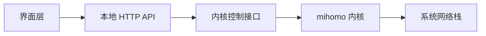

<div align="center">

# 折跃 <sub>Zheyue</sub>

**一套自绘控制台，把代理内核带进 Windows 与 Android。**

  

`Windows 10 1903+ · Android 8.0+ (arm64-v8a)`

[下载安装包](https://github.com/DIS98/zheyue/releases) · [项目主页](https://dis98.github.io/zheyue/) · [使用指南](docs/guide.md) · [架构说明](docs/architecture.md)

</div>

## 目录

1. [软件介绍](#intro)
2. [功能](#features)
3. [快速开始](#start)
4. [使用方法](#usage)
5. [开发逻辑](#arch)
6. [下载与版本](#downloads)
7. [目录结构](#layout)
8. [许可与第三方组件](#license)
9. [常见问题](#faq)

<a id="intro"></a>
## 软件介绍

折跃是一套跨平台代理内核控制台。它不提供节点、不修改内核、不做账号体系，只做一件事：把成熟的代理内核包进应用里，再用自己写的界面把配置、节点、连接、规则和日志管起来。

两端共享同一套产品语义与版本规则，但各自独立构建、独立发版。Windows 是原生桌面界面加本地 HTTP 后端；Android 是 Compose 界面、同进程 Go 内核与系统 VPN 服务。界面不另造状态，延迟、命中规则、连接链一律从内核控制接口读取。

本仓库开源的是控制台代码与构建脚本。代理内核、地理数据与运行时依赖以各自上游许可随安装包分发，源码仓库不内置这些二进制。

> 项目定位、能力边界与版本状态以本页和 [项目主页](https://dis98.github.io/zheyue/) 为准。

<a id="features"></a>
## 功能

- **六页控制台** — 概览、代理、连接、规则、日志、配置。两端采用一致的导航结构，同一件事在两端的入口位置相同。
- **节点与测速** — 策略组展开、延迟分级着色、单节点 / 整组 / 批量测速、历史趋势与丢包率，点选即切换。
- **连接与规则** — 实时连接列表按流量排序，按主机或进程过滤，单条断开；输入域名让内核真连一次，返回实际命中的规则与链路。
- **订阅与配置** — 链接、粘贴、拖拽三种导入方式；多订阅合并后先经内核校验，通过才写入；备份可整份导出导入。
- **流量与统计** — 双线实时图、今日 / 本月 / 近七日统计落盘累计，跨重启保留；规则集可单个或全部更新。
- **接管方式** — 系统代理、TUN、规则 / 全局 / 直连模式、开机自启与启动联动。系统代理只写当前用户配置，TUN 默认关闭。
- **Android 原生集成** — Go c-shared 编译进 APK，同进程加载；系统 VPN 服务接管流量，不使用子进程传递 fd。
- **应用内升级** — 版本清单 + SHA-256 与字节数双重校验 + 断点续传；校验不符直接删包重试，不落盘污染。
- **离线优先** — 地理数据与规则集随包分发，首次启动只做本地拷贝，不联网补数据。

<a id="start"></a>
## 快速开始

### 1. 下载对应端的安装包

到 Releases 取最新一版。Windows 是单文件离线安装包，Android 是 arm64-v8a 的 APK。

```text
Releases → windows-2.6.17 → ClashDeck-Setup-2.6.17-ced81c17-clean.exe
Releases → android-2.2.0  → Zheyue-2.2.0-08c4c47a.apk
```

### 2. Windows：安装并启动

双击安装包走四步向导，当前用户安装、不需要管理员、不写系统级配置、不装服务。首次运行若出现系统安全提示，选择「更多信息 → 仍要运行」。

```text
# 普通启动：双击主程序
# 只有使用 TUN 模式时才需要管理员启动
start-admin.cmd

# 静默安装 / 卸载
ClashDeck-Setup-2.6.17-ced81c17-clean.exe --silent
uninstall.exe --silent
```

### 3. Android：授权并连接

安装 APK 后打开应用，在概览页打开一键连接并授予 VPN 权限；随后选择模式与分流策略即可。

```text
# 从源码构建（两步）
bash tools/build-core.sh        # Go → libclash.so
./gradlew assembleRelease       # 产物：app/build/outputs/apk/release/app-release.apk
```

### 4. 导入订阅并激活

在配置页粘贴订阅链接或 YAML 内容，激活后回到概览页启动。内核路径默认指向随包内核，无需手动指定。

```text
# 自检（面板运行时）
node tools/selftest.js

# Android 构建门禁
bash tools/gate.sh
```

<a id="usage"></a>
## 使用方法

### 日常操作

- 测速：点节点右侧延迟数字测单个，点组卡片「测速」测整组，概览页可批量测主策略组。
- 规则预判：规则页输入域名，内核真连一次并返回实际命中的规则与出口。
- 模式切换：规则 / 全局 / 直连；节点点选即切换；系统代理与 TUN 独立开关。
- 配置页：导入订阅、备份导出导入、测速地址与超时、端口设置、启动联动、订阅更新间隔。
- 日志：按级别筛选、关键字过滤、暂停滚动、导出；Android 复制日志默认脱敏。

### Windows 注意项

- 关窗口不退出，程序收进托盘；托盘右键「退出」才真正结束。
- 升级安装会原样保留配置与订阅数据；卸载时可选择是否一并删除这些数据。
- 绿色版与安装版各自持有独立的数据目录，互不共享。
- TUN 与同类工具默认端口相同，不能同时运行；需要共存时先改端口。

### Android 注意项

- 系统同一时间只允许一个 VPN 服务；开机自启需要先完成过一次 VPN 授权。
- 本应用自身流量绕过隧道，避免内核出站回环。
- 应用内升级：首页顶部横幅 → 下载 → 校验 → 拉起系统安装器；后台时改发通知。
- 版本号只增不减，系统拒绝降级安装；回退需先导出订阅再卸载重装。

### 常用配置项

- 端口：Web 8787、混合 7897、SOCKS 7898、HTTP 7899、控制 9097（Android 控制口 9090）。
- 测速地址可随时修改并立即生效，超时范围 1000–30000 毫秒；非法地址会被拒绝。
- 订阅自动更新间隔设为 0 表示只手动更新；应用不运行时不会同步。

<a id="arch"></a>
## 开发逻辑



### 模块划分

| 位置 | 职责 |
| --- | --- |
| `windows/server.js` | 零第三方依赖的本地后端：HTTP API、静态资源、内核进程管理与配置生成 |
| `windows/src/Desktop` | WPF 原生界面、主题、自绘双线流量图 |
| `windows/src/Setup · SysProxy · Uninstaller` | 安装器、系统代理工具与卸载器 |
| `android/app/src/main` | Kotlin + Compose 六页界面、VpnService、内核控制接口封装 |
| `android/core-go` | Go c-shared 桥接与手写 JNI 胶水层 |
| `android/tools` | 内核交叉编译、版本门禁、出包与校验脚本 |

### 关键设计决策

- **界面不算数据** — 延迟、命中规则、连接链全部来自内核控制接口。界面自己推算的值不作为判据，避免两套状态互相矛盾。
- **配置写入是单事务** — 运行期配置先写临时文件再原子替换；多订阅合并生成后必须通过内核校验才落盘；启停与配置生成走串行闸门，防止并发抢端口。
- **内核同进程** — 移动系统上进程创建会关闭非白名单继承 fd，因此把内核编成 c-shared 库同进程加载，而不是起子进程再传 fd。
- **fd 所有权清晰** — VPN 服务建立后把 fd 交给内核；仅当启动失败或未启动时由服务自己关闭。应用自身流量绕过隧道，防止出站回环。
- **升级可验证** — 同一份产物生成版本清单，包内校验值与清单同源；下载后做 SHA-256 与字节数双校验，不符即丢弃重试。
- **权限最小化** — 系统代理只写当前用户配置；TUN 默认关闭且仅在需要时提权；移动端不申请与功能无关的权限。

<a id="downloads"></a>
## 下载与版本

所有二进制都放在 Releases，不进源码仓库。当前版本：**Windows 2.6.17 / Android 2.2.0**。

| 安装包 | 体积 | 说明 | Release |
| --- | --- | --- | --- |
| `ClashDeck-Setup-2.6.17-ced81c17-clean.exe` | 73,317,232 B | Windows 单文件离线安装包，当前用户安装 | [windows-2.6.17](https://github.com/DIS98/zheyue/releases/tag/windows-2.6.17) |
| `Zheyue-2.2.0-08c4c47a.apk` | 42,749,680 B | Android arm64-v8a 安装包 | [android-2.2.0](https://github.com/DIS98/zheyue/releases/tag/android-2.2.0) |

下载后请核对文件体积；Release 说明里附有校验方式。

<a id="layout"></a>
## 目录结构

```text
zheyue/
├── windows/              桌面端：本地后端 + 原生界面 + 构建脚本
│   ├── server.js         HTTP API 与内核进程管理
│   ├── src/              WPF 界面、安装器、系统代理工具
│   ├── public/           旧版静态资源
│   ├── rules/            分流规则配置
│   └── tools/            自检与打包脚本
├── android/              移动端：Compose 界面 + 同进程内核
│   ├── app/src/main/     Kotlin 源码、资源与清单
│   ├── core-go/          Go c-shared 桥接与 JNI 胶水
│   └── tools/            内核编译、门禁、出包脚本
├── docs/                 使用指南、架构说明、第三方组件声明
└── README.md
```

<a id="license"></a>
## 许可与第三方组件

本项目自研代码采用 **MIT License**（见 [LICENSE](LICENSE)），Copyright (c) 2026 DIS98。

随安装包分发的第三方组件各自保留其许可，完整署名见 [THIRD-PARTY-NOTICES.md](THIRD-PARTY-NOTICES.md)：

| 组件 | 许可 | 说明 |
| --- | --- | --- |
| mihomo / Clash.Meta | GPL-3.0 | 代理内核，随安装包分发；源码与许可见上游项目 |
| Node.js | MIT | 桌面端内置运行时 |
| .NET | MIT | 桌面界面运行时 |
| geoip / geosite / Country.mmdb | 各自上游许可 | 随包离线地理数据，仓库不内置 |
| Jetpack Compose | Apache-2.0 | 移动端界面框架 |

<a id="faq"></a>
## 常见问题

<details><summary>这个项目提供节点或订阅吗？</summary>

不提供。它只是控制台，订阅内容由使用者自行导入。

</details>

<details><summary>需要管理员或 root 吗？</summary>

常规使用不需要。只有桌面端 TUN 模式需要管理员；移动端使用系统 VPN 授权，不需要 root。

</details>

<details><summary>为什么两端版本号不一样？</summary>

两端独立构建、独立发版，版本号各自按三段式演进，互不联动。

</details>

<details><summary>源码仓库为什么没有内核二进制？</summary>

内核与地理数据属于上游组件，以各自许可随安装包分发；仓库只放本项目自研代码。

</details>

---

本项目只发布与产品本身有关的内容：源码、文档、安装包。任何与开发机环境、内部分发通道或个人配置有关的内容均不包含在仓库中。
